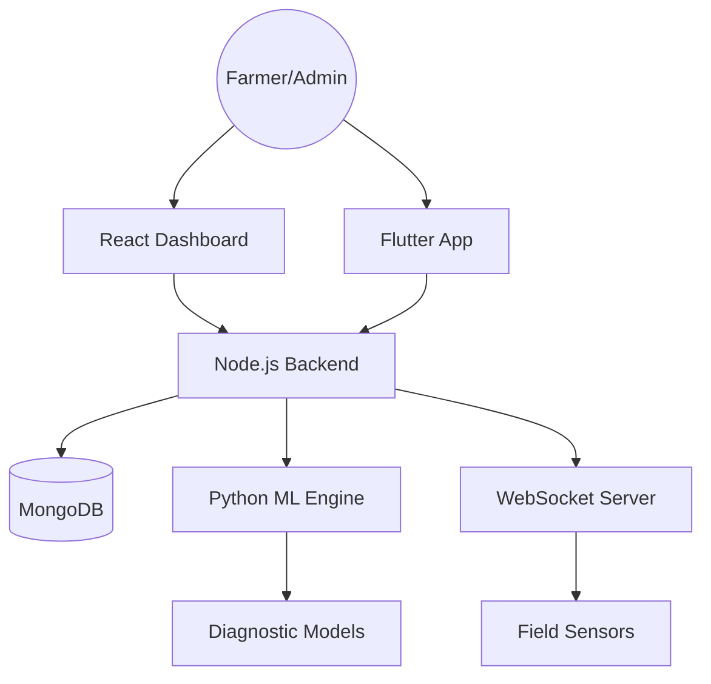

# 🌾 Krishi Mitra: The Ultimate AgriTech Engineering Showcase

> A production-grade, full-stack ecosystem designed to revolutionize agriculture through AI/ML, real-time telemetry, and high-performance engineering. Built as a flagship project for **Year 2 Advanced Engineering**.

---

## 🛠️ Multi-Stack Excellence

Krishi Mitra demonstrates mastery across the entire software development lifecycle:

### 🚀 Full-Stack Engineering (Front to Back)
- **Frontend**: High-fidelity React 19 dashboard with **Framer Motion** animations and **Recharts** analytics.
- **Backend**: Robust Node.js API with custom middleware, JWT security, and **MongoDB** for high-velocity data retrieval.
- **Mobile**: Cross-platform Flutter application for field-based crop management and diagnostic reporting.

### 🧠 AI & Machine Learning
- **Deep Learning Microservice**: Python FastAPI engine running automated pest and disease diagnosis.
- **Natural Language Processing**: Integrated AI Agronomist (LLM) for real-time agricultural advisory.
- **Predictive Analytics**: Forecasting yield contribution and price index trends.

### 🌐 Data Analytics & IoT
- **Real-time Telemetry**: WebSocket-driven dashboard visualizing live soil moisture, nitrogen, and humidity levels.
- **Market Intelligence**: Advanced data visualization showing regional price trends and yield distribution.
- **Algorithm Design**: Implemented **Dijkstra's Route Optimization** for last-mile harvest delivery.

### ☁️ DevOps & Infrastructure
- **Containerization**: Full Docker support across all services (API, AI, and Web).
- **Infrastructure as Code**: Blueprints-driven deployment via Render for seamless multi-service orchestration.
- **CI/CD Readiness**: Structured for professional automated testing and deployment pipelines.

---

## 📂 Project Architecture

---

## 📂 Directory Map

- **`apps/web`**: React 19 Dashboard (Analytics + UI).
- **`apps/mobile`**: Flutter App (Field Work).
- **`services/api`**: Express Server (Core Logic + WebSocket).
- **`services/ai`**: FastAPI Server (ML Models + RAG).
- **`docs`**: Technical Architecture & Deep Dives.

---

## 🚀 One-Click Deployment
To host this entire platform, simply use the provided **Render Blueprint**:
1. Click **New +** -> **Blueprint**.
2. Connect this repository.
3. Apply the `render.yaml` configuration.

---

## 👨‍💻 Author
**Ayush Shukla**  
[GitHub](https://github.com/ayushshukla1807) | [LinkedIn](https://linkedin.com/in/ayushshukla1807)
